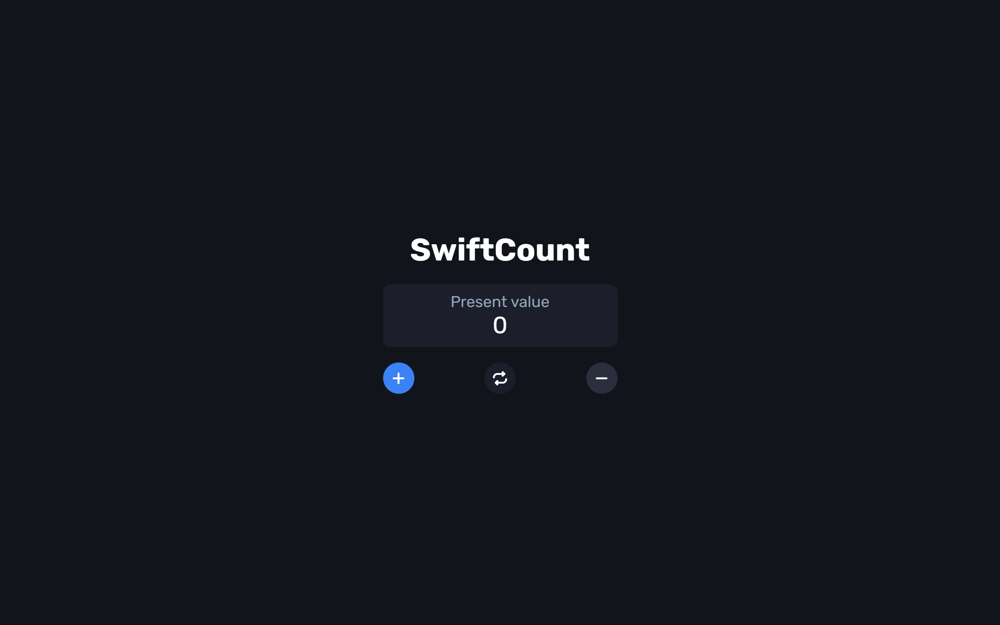

# SwiftCount 🔢

A sleek, modern, and minimalist counter application built with HTML, CSS, and JavaScript.

---

## 📱 Interface Preview

<p align="center">
  
</p>

---

## ✨ Features

- **Increment / Decrement:** Smooth numerical state updates.
- **Reset State:** Instantly resets the counter back to zero.
- **Modern Dark UI:** Ergonomic dark theme with clean visual hierarchy.
- **Responsive Layout:** Optimized for mobile and desktop screens.

---

## 🛠️ Tech Stack

- **Frontend:** HTML5, CSS3, JavaScript (Vanilla JS)
- **Styling:** Custom CSS Custom Properties (Variables), Flexbox

---

## 🚀 Getting Started

### Prerequisites
All you need is a modern web browser (Chrome, Firefox, Edge, Safari).

### Installation
1. Clone the repository:
   ```bash
   git clone [https://github.com/your-username/SwiftCount.git](https://github.com/your-username/SwiftCount.git)